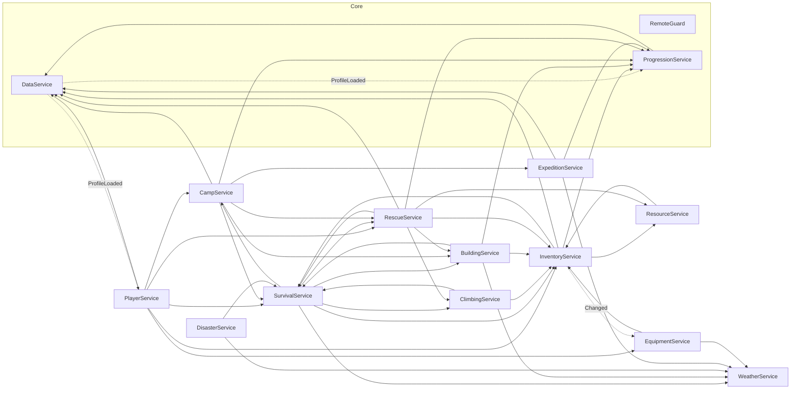
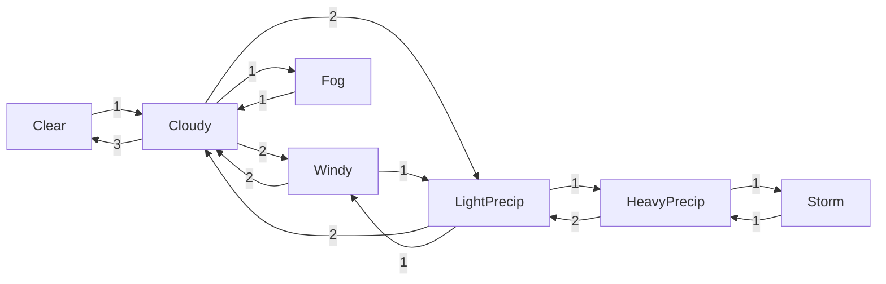

# Architecture

Mountain-survival expedition game for Roblox (Luau, synced with Rojo). This document describes
what the code in `src/` **actually does**. Anything not yet in code is marked **(planned)**.
Status by milestone is tracked in [ROADMAP.md](ROADMAP.md).

> Status: playable build, **not yet play-tested in Roblox Studio**. The pure logic layer
> (survival, warmth, inventory, weather, terrain) is unit tested, and the real server and
> client code boots and plays a scripted expedition in a headless Roblox emulation
> (`tests/spec_boot.luau`, see [TESTING.md](TESTING.md)). Nothing has run inside the real
> engine yet: physics, rendering, replication and DataStores are unverified.

Contents

1. [Architecture overview](#1-architecture-overview)
2. [Workstreams mapped to files](#2-workstreams-mapped-to-files)
3. [Dependency graph](#3-dependency-graph)
4. [Folder structure and Roblox instance tree](#4-folder-structure-and-roblox-instance-tree)
5. [Data models](#5-data-models)
6. [Remote architecture](#6-remote-architecture)
7. [Service architecture](#7-service-architecture)
8. [Item architecture](#8-item-architecture)
9. [Equipment architecture](#9-equipment-architecture)
10. [Survival architecture](#10-survival-architecture)
11. [Building architecture](#11-building-architecture)
12. [Weather architecture](#12-weather-architecture)
13. [Disaster architecture](#13-disaster-architecture)
14. [Security model](#14-security-model)
15. [Performance notes](#15-performance-notes)
16. [CollectionService tag contract (hand-built maps)](#16-collectionservice-tag-contract-hand-built-maps)
17. [World generation](#17-world-generation)

---

## 1. Architecture overview

### Server-authoritative model

The server owns every gameplay fact: stats, inventory, injuries, weather, time of day,
structures, disasters, checkpoints, XP. Clients only:

- **render** state the server publishes (Player attributes, `ReplicatedStorage.WorldState`
  attributes, `Lighting.ClockTime`, and a handful of server-to-client events), and
- **send intents** ("use stack 7", "build campfire here", "start climbing") through a fixed set of
  validated remotes, or trigger server-created ProximityPrompts.

The one deliberate exception is **character motion**. Roblox gives each client network ownership
of its own character, so walking and the climbing motion are simulated on the client. The server
constrains it instead of driving it: it sets `WalkSpeed` / `JumpHeight` every survival tick from
the survival modifiers, compares real displacement against them (snapping back sustained
violations), decides whether a climb may start or must stop, and checks vertical climb speed.
See [Security model](#14-security-model).

### Registry service locator

`src/server/Registry.luau` is a 20-line service locator. Services never `require` each other;
they call `Registry.get("Name")` **at call time**. This avoids require cycles (Survival needs
Rescue to down a player, Rescue needs Survival to stop resting) and keeps each service file
independent.

Bootstrap (`src/server/init.server.luau`):

1. `Players.CharacterAutoLoads = false`, so nobody spawns over an empty map.
2. `WorldBuilder.build()` generates the world unless `Workspace.Mountain` already exists
   (section 17). It always ends by setting the workspace attribute `WorldReady = true`.
3. Every service in `ORDER` is `require`d and registered. Registering everything before any
   `Init` means lookups inside `Init`, `Start` and handlers always resolve.
4. `Init()` on every service in order: create remotes/folders, register remote handlers.
   `RemoteGuard` is first because the others call `RemoteGuard.on` in their `Init`.
5. `Start()` on every service in order: connect events, start loops.
6. `CharacterAutoLoads = true` and `LoadCharacter` for everyone who joined during the build.
7. A deferred one-line `[Report]` print counts camps, checkpoint rings, sleep spots, supply
   crates, outfitters, wood and water sources, hazards, summit markers and world parts. A zero
   means that part of the world failed to build.

Order: RemoteGuard, DataService, ProgressionService, InventoryService, SurvivalService,
ClimbingService, WeatherService, BuildingService, ResourceService, CampService, RescueService,
DisasterService, ExpeditionService, EquipmentService, PlayerService.

Services talk through two mechanisms only: direct calls via `Registry.get`, and three `Signal`s
(`DataService.ProfileLoaded`, `InventoryService.Changed`, `WeatherService.StateChanged`).

### PlayerStore

`src/server/PlayerStore.luau` holds the **single server-side record per player**
(`PlayerStore.Record`, see [Data models](#5-data-models)). Every service reads and mutates the
same record; there is no per-service copy of player state. `PlayerStore.getActive(player)` is the
standard guard: it returns `record, character, humanoid, root` only when the profile has loaded
(`record.ready`) and the character is alive, so handlers can early-out with one line.

### Pure Logic layer, tested outside Roblox

`src/shared/Logic/*` (SurvivalModel, WarmthModel, InjuryModel, InventoryModel, WeatherModel,
TerrainModel) contains the gameplay and terrain math and has **no Roblox service calls**.
Randomness is injected (`WeatherModel.pickNext(id, rng)`) or kept in services. These modules,
plus everything in `src/shared/Config`, run in a plain Luau VM under `tests/harness.luau`, which
fakes the `script` tree and stubs `Vector3`/`Color3`. Services are thin: sample the world, call
the model, apply the result, publish.

### Tag-based world contract

Gameplay never looks objects up by path. Everything interactive is found through
CollectionService tags (`Camp`, `SupplyCrate`, `Outfitter`, `WoodSource`, `WaterSource`,
`SleepSpot`, `RockfallZone`, `SectionEnd`, `Climbable`, `WaterVolume`) plus attributes and named
children. The generated world uses exactly the same tags, so a level designer can replace it
with a hand-built Studio map named `Workspace.Mountain` and every system keeps working. Full
contract in [section 16](#16-collectionservice-tag-contract-hand-built-maps).

---

## 2. Workstreams mapped to files

| Workstream | Owns | Notes / status |
|---|---|---|
| Lead Architect | `default.project.json`, `src/server/init.server.luau`, `Registry.luau`, `PlayerStore.luau`, `src/shared/Net/Remotes.luau`, `docs/` | Bootstrap order, service contracts, remote list |
| Gameplay | `Config/GameConfig.luau`, `Services/ExpeditionService.luau`, `Services/CampService.luau`, `Services/PlayerService.luau` | Director (storms after Camp 1 and Camp 2), checkpoints, check-in rings, sleep spots, respawn, summit |
| Survival | `Config/SurvivalConfig.luau`, `Config/InjuryDefs.luau`, `Logic/SurvivalModel.luau`, `Logic/WarmthModel.luau`, `Logic/InjuryModel.luau`, `Services/SurvivalService.luau` | Unit tested, including climate tests per camp |
| Climbing | `Config/ClimbConfig.luau`, `Services/ClimbingService.luau`, `client/Controllers/ClimbingController.luau` | Needs Studio feel testing. Ladders are TrussParts (engine climbing) |
| Inventory / Equipment | `Config/ItemDefs.luau`, `Config/LoadoutConfig.luau`, `Logic/InventoryModel.luau`, `Services/InventoryService.luau`, `Services/EquipmentService.luau`, `World/GearFactory.luau`, `client/Controllers/InventoryController.luau`, `PanelController.luau`, `GearMenuController.luau`, `HotbarController.luau` | Inventory model stress-tested (10k ops) |
| Building | `Config/RecipeDefs.luau`, `Services/BuildingService.luau`, `client/Controllers/BuildBookController.luau` | 5 of 11 recipes implemented |
| Weather | `Config/WeatherDefs.luau`, `Logic/WeatherModel.luau`, `Services/WeatherService.luau`, `client/Controllers/WeatherController.luau` | Always snow; day/night cycle. Client rendering is cosmetic only |
| Disaster | `Services/DisasterService.luau` | Rockfall mechanics only (used for the valley avalanche slope and the serac band); real avalanche **(planned)** |
| World | `Config/WorldLayout.luau`, `Config/ZoneDefs.luau`, `Logic/TerrainModel.luau`, `World/WorldBuilder.luau`, `World/CampKit.luau`, `World/RouteKit.luau`, tag contract | v3: natural heightfield terrain written with `WriteVoxels` (section 17) |
| 3D Art | `World/AssetFactory.luau` (props, tents, camp buildings), `World/GearFactory.luau` (character gear), `docs/ART_DIRECTION.md`, `docs/ASSET_SPECS.md` | Stylized v2 look built from primitive Parts; no meshes or textures; particle textures are engine defaults |
| UI/UX | `client/UI/UI.luau`, `client/ClientState.luau`, `client/init.client.luau`, the HUD/Notification/Title/Inventory/BuildBook/Panel/GearMenu/Hotbar/Summary/Condition controllers | All UI built in code |
| Multiplayer | `Services/RescueService.luau`, Give/Treat in `InventoryService`, Ping in `ExpeditionService`, rejoin stash in `PlayerService`, `client/Controllers/PingController.luau`, carry/drop in `MovementController` | Needs multi-client Studio testing |
| Audio / VFX | `client/AudioConfig.luau`, `AudioController`, `PlaySound` and `Banner` remotes, particles in `DisasterService`/`WeatherController`/`ConditionController`, `FootprintController`, `AmbienceController`, fire/smoke in `AssetFactory` | Every sound id in AudioConfig is `""`, so the game is **silent** until audio art supplies ids |
| Data | `Services/DataService.luau`, `Services/ProgressionService.luau`, `Config/ProgressionConfig.luau` | Needs live DataStore testing |
| Security | `Security/RemoteGuard.luau`, `Util/Validate.luau`, `Services/PromptUtil.luau`, range/ownership checks in each service | See section 14 |
| Performance | Single survival loop, publish thresholds, pooling, chunked terrain writes (see section 15) | No profiling done yet |
| QA | `tests/check.sh`, `tests/run.sh`, `tests/compile_check.luau`, `tests/harness.luau`, `tests/spec*.luau`, `tests/mock/`, `tests/render/`, `docs/TESTING.md` | Unit, terrain and headless boot suites; preview renderer; manual Studio plan |

### Client controllers

`src/client/init.client.luau` requires the controllers in a fixed order, runs every `Init()`
(build UI, local instances; no remotes), then every `Start()` (connect remotes and input) each in
its own thread. Every step is `pcall`ed, so one broken controller only loses its own feature.
Controllers present but missing from `ORDER` still start, last, with a warning.

| Controller | Does | Remotes / state it uses |
|---|---|---|
| NotificationController | event pill (top centre) for banners, big warning band for capitalised danger messages, toasts | `Banner`, `Notify` |
| TitleController | title screen on join (Play / How to play / Gear); HUD and hotbar hide while it is open | `ClientState` |
| PanelController | Outfitter (shop-style cards by slot) and supply-crate panels | `OpenPanel`, `Outfit`, `Supply` |
| InventoryController | pack screen (Tab / I): worn slots, contents, item actions, body status | `InventorySync`, `GetSnapshot`, `Inventory` |
| GearMenuController | H: show/hide helmet, mask, goggles, switch the headlamp | `GearToggle`, `GearHelmet/GearMask/GearGoggles/GearLight` attributes |
| HotbarController | keys 1-4: water, food, first aid, tool, auto-filled from the latest snapshot | `Inventory` (through the inventory snapshot) |
| BuildBookController | Build Book (B), placement ghost, R rotate | `Build` |
| HUDController | teammates, compass + clock, altitude/temperature card, stat icons, stamina bar, left-edge buttons (pack, gear, build, route panel M, camera V), downed overlay with hold-to-confirm "Give up" | Player attributes, `WorldState`, `GiveUp` |
| ClimbingController | C to grab/let go, W/A/S/D on the wall, Space jumps off; AlignPosition/AlignOrientation | `ClimbStart`, `ClimbStop`, `ClimbForceStop` |
| MovementController | Shift sprint, jump reporting, stop resting on move, X sets down a carried teammate, hides the downed player's own prompts (`OwnerUserId`), sprint FOV, disables CoreGui backpack/player list/reset | `SetSprint`, `ReportJump`, `StopRest`, `DropCarried` |
| AudioController | wind/snowfall/blizzard/fire ambience, breathing/heartbeat/shivering, one-shots, storm-banner sting | `PlaySound`, `Banner`, `WorldState`, Player attributes |
| WeatherController | Atmosphere/lighting from fog, cloud and time of day; client-only snow emitter above the camera, hidden when `InShelter`. No rain path | `WorldState` attributes, `Lighting.ClockTime` |
| ConditionController | breath vapour on every character below 4 C, cold/thin-air/downed screen grading and vignette, shiver, capped camera shake | `CameraShake`, Player attributes |
| PingController | G marks a spot; markers with name and live distance for 8 s, max 10 | `Ping`, `PingBroadcast` |
| SummaryController | end-of-expedition stats panel at the summit | `ExpeditionSummary` |
| FootprintController | pooled footprints on Snow/Glacier behind every character, fading faster in heavy snow | none (cosmetic) |
| AmbienceController | campfire flicker and lamp brightness by time of day | none (cosmetic) |

---

## 3. Dependency graph

Arrows mean "calls through `Registry.get`" (dotted arrows are Signal subscriptions).
Every service also calls `RemoteGuard` for notifications; those edges are omitted for clarity.
All services require `PlayerStore` directly. `BuildingService`, `ResourceService` and
`WorldBuilder` require `AssetFactory` directly; `EquipmentService` requires `GearFactory` (which
requires `AssetFactory`); `WorldBuilder` also requires `RouteKit` and `TerrainModel`, and loads
`CampKit` with a fallback if it fails.



`WeatherService.StateChanged` is consumed by WeatherService itself (it fires the weather
banners and severe-weather notifications).

Key call sites:

| Caller | Callee: functions used |
|---|---|
| PlayerService | CampService.spawnFor; SurvivalService.refreshCharacterFilter, refreshGear; EquipmentService.refresh; InventoryService.setupLoadout, sync; RescueService.releaseAll, evacuate, resetCharacter; DataService.ProfileLoaded |
| SurvivalService | WeatherService.sampleAt; BuildingService.environmentAt; InventoryService.weightRatio, wornItems; CampService.isInCamp, recoverToCheckpoint; ClimbingService.tick, forceStop; RescueService.down |
| ClimbingService | SurvivalService.groundRaycastParams, setResting; InventoryService.heldItemId |
| InventoryService | SurvivalService.refreshGear, changeHealth; ResourceService.spawnContainer; ProgressionService.rankIndex; DataService.get, markDirty |
| BuildingService | SurvivalService.setResting; InventoryService.count, add (tent pack-up), removeAll, useToolCharge, cookAll, boilContainers, fillContainers; WeatherService.sampleAt; ProgressionService.hasBlueprint, achieve |
| ResourceService | InventoryService.add, fillContainers, sync |
| CampService | BuildingService.registerPermanentFire, registerShelter; SurvivalService.setResting (sleep spots); ProgressionService.award, rankIndex; ExpeditionService.onCheckpoint, sectionComplete; RescueService.releaseAll; DataService.get, markDirty |
| RescueService | SurvivalService.setResting; ClimbingService.forceStop; InventoryService.count, removeAll, takeAll, add, sync; ResourceService.spawnContainer; BuildingService.environmentAt; ProgressionService.award; DataService.get, markDirty |
| DisasterService | SurvivalService.addInjury, changeHealth; WeatherService.params |
| ExpeditionService | WeatherService.force; ProgressionService.award; DataService.get, markDirty |
| EquipmentService | InventoryService.heldItemId, Changed; WeatherService.sampleAt |

---

## 4. Folder structure and Roblox instance tree

```
Game/
├── default.project.json         Rojo project (below)
├── rokit.toml                   rojo 7.4.4, stylua 2.0.2, selene 0.27.1
├── selene.toml, roblox_lite.yml offline Roblox std for selene
├── stylua.toml
├── docs/                        ARCHITECTURE, ROADMAP, TESTING, ART_DIRECTION, ASSET_SPECS, previews/
├── src/
│   ├── shared/                  -> ReplicatedStorage.Shared (Folder)
│   │   ├── Config/              ClimbConfig, GameConfig, InjuryDefs, ItemDefs, LoadoutConfig,
│   │   │                        ProgressionConfig, RecipeDefs, SurvivalConfig, WeatherDefs,
│   │   │                        WorldLayout, ZoneDefs
│   │   ├── Logic/               InjuryModel, InventoryModel, SurvivalModel, TerrainModel,
│   │   │                        WarmthModel, WeatherModel
│   │   ├── Net/Remotes.luau     every remote: kind, schema, rate limit
│   │   └── Util/                Signal, Validate
│   ├── server/                  -> ServerScriptService.Server (Script, from init.server.luau)
│   │   ├── init.server.luau     bootstrap
│   │   ├── Registry.luau        service locator
│   │   ├── PlayerStore.luau     per-player record
│   │   ├── Security/RemoteGuard.luau
│   │   ├── Services/            14 services + PromptUtil helper
│   │   └── World/               WorldBuilder, CampKit, RouteKit, AssetFactory, GearFactory
│   └── client/                  -> StarterPlayer.StarterPlayerScripts.Client
│       ├── init.client.luau     bootstrap (Init all, then Start all)
│       ├── ClientState.luau     client mirror (inventory snapshot, open panel)
│       ├── AudioConfig.luau     sound ids (all empty until audio art exists)
│       ├── Controllers/         17 controllers (table in section 2)
│       └── UI/UI.luau           theme + declarative helpers (all UI built in code)
└── tests/                       check.sh, run.sh, compile_check.luau, harness.luau,
                                 spec.luau, spec_terrain.luau, spec_boot.luau, mock/, render/
```

Rojo mapping (`default.project.json`):

| Filesystem | Instance | Class |
|---|---|---|
| `src/shared` | `ReplicatedStorage.Shared` | Folder of ModuleScripts |
| `src/server` | `ServerScriptService.Server` | Script (from `init.server.luau`); siblings become child ModuleScripts, so `script.Services.X` resolves |
| `src/client` | `StarterPlayer.StarterPlayerScripts.Client` | LocalScript (from `init.client.luau`) with child ModuleScripts |
| (properties) | `Workspace` | `StreamingEnabled = true`, `Gravity = 196.2` |
| (properties) | `Lighting` | `ClockTime 9.5`, `Brightness 2.5`, `GlobalShadows true`, env diffuse/specular 1 (the server drives `ClockTime` from then on) |

Instances created at runtime:

| Instance | Created by | Contents |
|---|---|---|
| `ReplicatedStorage.Remotes` | RemoteGuard.Init | one RemoteEvent/RemoteFunction per entry in Remotes.luau |
| `ReplicatedStorage.WorldState` | WeatherService.Init | weather and clock attributes (section 5) |
| `Workspace.Terrain` voxels | WorldBuilder (only if no `Workspace.Mountain`) | the heightfield mountain (Snow, Glacier, Rock) |
| `Workspace.Mountain` | WorldBuilder (only if absent) | `SafetyFloor` and `SnowSkirt` parts, `Scenery` (backdrop peaks), `Camps`, `Trees`, `Rocks`, `Resources` (wood), `RockfallZone_ValleyAvalanche`, `RockfallZone_SeracFall`, `SectionEnd` + summit flag/cairn, `Route` (bridges, ladders, `Markers`, signs, rope fences, fixed ropes) |
| `Workspace.Structures` | BuildingService.Init | player-built fires, tents, tarps, wind walls, markers |
| `Workspace.GroundItems` | ResourceService.Init | dropped items, evacuated players' packs |
| `Workspace.DisasterEffects` | DisasterService.Init | dust emitters, pebbles, pooled boulders |
| `<Character>.Gear` | EquipmentService | clothing shells, head gear, backpack, harness, stowed and held gear |
| `Lighting.Atmosphere` | WorldBuilder (if missing) | haze |

---

## 5. Data models

### PlayerStore.Record (server only, never replicated as a whole)

```lua
{
  player, ready: boolean,            -- ready once the profile loaded and loadout applied
  profile: Profile,                  -- live DataService profile (same table)
  survival: SurvivalModel.State,
  inventory: InventoryModel.Inventory,
  worn: { [ClothingSlot]: itemId },  -- Head, Face, Eyes, BaseLayer, Jacket, Gloves, Pants, Boots
  backpackId: string,                -- set by InventoryService.setupLoadout (default pack_medium)
  heldUid: string?,                  -- stack held in hand (ice axe)
  -- action state
  sprintRequested, exertion,         -- idle | walk | sprint | climb | carry | rest
  climbing: { normal, lastY, startedAt }?,
  resting, restingAtCamp, downed, bleedOut,
  carrying: Player?, carriedBy: Player?,
  peakY: number?, airborne,          -- fall tracking
  -- expedition (not persisted)
  checkpoint: number,                -- index of last signed camp (1 = Base Camp)
  outfitterTaken: { [itemId]: true },
  supplyTaken: { [crateId]: { [itemId]: count } },
  stats: ExpeditionStats,            -- startedAt, maxElevationM, distanceStuds, highestCheckpoint,
                                     -- weatherSurvived{}, disastersSurvived, teammatesRescued,
                                     -- itemsConsumed, injuries, resourcesCollected, sectionComplete
  lastPosition, lostSince,
  -- movement sanity
  lastGoodPosition: Vector3?, speedViolation: number, groundY: number?,
}
```

`PlayerStore.teleported(record)` must be called after any server-side teleport so movement and
fall checks start fresh. On leave, the record is stashed for `REJOIN_GRACE_SECONDS = 600` keyed
by UserId; rejoining the **same server** inside that window restores it (pack, injuries,
checkpoint, allowances). The stash is the only copy, so nothing is duplicated.

### SurvivalModel.State

```lua
{
  stamina, hunger, thirst, fatigue,       -- 0..100 (stamina capped by modifiers.maxStamina)
  oxygen,                                 -- 35..100, derived from elevation each step
  altitudeSickness,                       -- 0..100
  wetness,                                -- 0..1
  warmth = { Head, Torso, Hands, Legs, Feet },        -- 0..100 each
  frostExposure = { Hands, Feet, Head },  -- seconds-ish accumulator
  staminaCooldown, exhaustedLock, criticalColdTime,
  injuries = { [injuryId]: { id, age, splinted, campRest } },
  buffs = { [buffId]: secondsRemaining }, -- Electrolytes, HandWarmer
}
```

### Inventory / Stack

```lua
Inventory = { stacks: { Stack }, nextUid: number }
Stack     = { uid: string, itemId: string, qty: number, data: { [string]: any }? }
-- data examples: water_bottle { ml, treated, hot, hotUntil }, lighter { uses }
```

Rules (InventoryModel): stacks merge up to `maxStack` only when both have no `data`;
containers never merge; container weight = item weight + `ml * 0.001` kg; `removeAll(cost)` is
atomic. Slot limit comes from the backpack; the hard weight cap (130% of pack limit) is enforced
by `InventoryService.add`.

`InventorySync` snapshot sent to the owner:
`{ stacks, worn, backpackId, heldUid, weight, weightLimit, slots }`.

### Persisted Profile (DataService)

DataStore `MountainProfiles_v1`, key `u_<UserId>`, stored value `{ profile = Profile, lock = { jobId, time } }`.

```lua
Profile = {
  schema = 1,
  xp: number,
  loadout: { [slot | "Backpack"]: itemId },   -- worn clothing + pack chosen at the outfitter
  blueprints: { [recipeId]: true },           -- recipes with unlockedByDefault count as known anyway
  achievements: { [id]: unixTime },           -- e.g. first_shelter
  totals = { expeditions, sectionsCompleted, summits, rescues, checkpoints, maxElevationM },
  settings = { cameraShake: boolean },        -- saved, but nothing reads it yet
}
```

Deliberately **not persisted**: pack contents, injuries, position, checkpoint. An expedition is a
session with friends; XP, unlocks and preferred loadout carry over.

### Attributes published to clients

Player attributes (server-written; numeric ones are only rewritten when they move by at least
the step shown, then rounded to that step):

| Attribute | Source | Step / type |
|---|---|---|
| Stamina, MaxStamina, Hunger, Thirst, Fatigue, Oxygen, Warmth | SurvivalService | 0.5 |
| AltitudeSickness | SurvivalService | 1 |
| WarmHead, WarmTorso, WarmHands, WarmLegs, WarmFeet | SurvivalService | 1 |
| Wetness | SurvivalService | 0.02 (0..1) |
| ElevationM | SurvivalService | 5 |
| TempC, WindMs | SurvivalService (air temp and effective wind at the player) | 0.5 |
| ClimbSpeed | SurvivalService | 0.1 |
| ColdLevel (`None/Mild/Moderate/Severe/Critical`), Exertion, Injuries (`"BrokenLeg*,Bleeding"`, `*` = splinted), Zone, Weather (display name) | SurvivalService | string |
| InShelter, NearFire, CanSprint, CanClimb, Resting | SurvivalService | bool |
| Weight (0.1 kg), WeightLimit, HeldItem | InventoryService.sync | number / string |
| Climbing | ClimbingService | bool |
| Downed, BleedOut, Carrying, CarriedBy | RescueService | bool / int / display name |
| Checkpoint, CheckpointName | PlayerService, CampService | int / string |
| XP, RankIndex, Rank | ProgressionService | |
| BuildingUntil | BuildingService | server time (`GetServerTimeNow`) when the build finishes |
| GearHelmet, GearMask, GearGoggles, GearLight | EquipmentService | bool (nil = shown / light off) |

`ReplicatedStorage.WorldState` attributes, written every 0.5 s: `WeatherFrom`, `WeatherTo`,
`WeatherBlend` (0..1), `WindMs`, `WindDirection` (unit Vector3), `Precipitation`, `Fog`,
`Cloud`, `TempOffsetC`, `ClockTime`. The server also writes `Lighting.ClockTime`, which
replicates.

Instance attributes: `Remaining` on WoodSources, `Builder` (UserId) on built structures,
`OwnerUserId` on a downed player's Revive/Carry prompts (MovementController hides them on that
player's own client), `WorldReady` on Workspace once the world build has finished.

---

## 6. Remote architecture

All remotes are declared in `src/shared/Net/Remotes.luau` and created by `RemoteGuard.Init`
in `ReplicatedStorage.Remotes`. Each client-to-server remote has exactly one handler
(`RemoteGuard.on`) and goes through: token-bucket rate limit -> schema validation (types,
ranges, NaN/inf, extra args rejected) -> `pcall`ed handler. A rejected RemoteFunction returns
`false, "Request rejected."`; a handler error returns `false, "Something went wrong."`.

### Client -> Server (14)

| Remote | Kind | Args (schema) | Rate / burst | Handler -> effect |
|---|---|---|---|---|
| SetSprint | Event | `boolean` | 8/s, 12 | SurvivalService: `record.sprintRequested` (server still decides exertion from real velocity, stamina, injuries) |
| ReportJump | Event | none | 3/s, 4 | SurvivalService: spend `JumpCost` stamina, reset regen delay |
| ClimbStart | Event | `Vector3` normal hint, magnitude <= 1.5 | 4/s, 6 | ClimbingService: validate and start, else `ClimbForceStop(reason)` |
| ClimbStop | Event | optional `boolean` (mantle) | 6/s, 8 | ClimbingService: end climb |
| Ping | Event | `Vector3` within 20000 of origin | 0.5/s, 3 | ExpeditionService: if within `PING_RANGE` (600) of the player, `PingBroadcast` to all |
| StopRest | Event | none | 4/s, 4 | SurvivalService.setResting(false) |
| DropCarried | Event | none | 2/s, 3 | RescueService.release (set down a carried teammate) |
| GiveUp | Event | none | 0.5/s, 2 | RescueService.evacuate, only while downed |
| GearToggle | Event | `oneOf(Helmet, Mask, Goggles, Light)`, `boolean` | 4/s, 8 | EquipmentService: show/hide a worn head item or switch the headlamp (needs a helmet with a lamp); cosmetic only, warmth always comes from what is worn |
| Inventory | Function | `oneOf(Use, Drop, Equip, Unequip, Give, Treat, Hold, Stow)`, `string(<=12)` stack uid (slot name for Unequip), optional `integer(1..2^53)` (target UserId for Give/Treat, qty for Drop) | 6/s, 10 | InventoryService -> `(ok, message)` then `InventorySync` |
| Outfit | Function | `string(<=32)` itemId | 4/s, 8 | InventoryService: must be near an `Outfitter`; wear clothing / switch pack / take one-off tool |
| Supply | Function | `string(<=32)` crateId, `string(<=32)` itemId | 4/s, 8 | InventoryService: must be near that `SupplyCrate`; per-player allowance |
| Build | Function | `string(<=32)` recipeId, `CFrame` (finite, within 20000) | 1/s, 3 | BuildingService: full validation, yields for the build timer, returns `(ok, message)` |
| GetSnapshot | Function | none | 2/s, 4 | InventoryService.snapshot or `nil` before ready |

### Server -> Client (9 RemoteEvents, no schema: the server is trusted)

| Remote | Args | Fired by | Client consumer |
|---|---|---|---|
| InventorySync | snapshot | InventoryService.sync | InventoryController (and HotbarController through it) |
| Notify | text, severity (`info/good/warn/danger`), key? | RemoteGuard.notify (per-key cooldowns) | NotificationController |
| OpenPanel | panelName (`Supply`/`Outfitter`), data | CampService prompts | PanelController |
| ClimbForceStop | reason? (`""`/nil = silent) | ClimbingService | ClimbingController |
| PingBroadcast | position, fromName, fromUserId | ExpeditionService | PingController |
| CameraShake | intensity, duration | SurvivalService (falls), DisasterService | ConditionController |
| ExpeditionSummary | summary table (see ExpeditionService.summaryFor) | ExpeditionService.sectionComplete (summit) | SummaryController |
| PlaySound | soundKey, position? | DisasterService (`"Rumble"`) | AudioController (key must exist in AudioConfig) |
| Banner | text, kind (`storm`/`checkpoint`/`info`) | WeatherService (state changes), ExpeditionService (storm warning, summit), CampService (new checkpoint) | NotificationController (event pill), AudioController (storm sting) |

### Why most world interactions are ProximityPrompts, not remotes

A ProximityPrompt created **by the server** fires `Triggered` **on the server** with the real
`Player`. That gives a free, engine-authenticated interaction channel with no custom remote, no
schema and nothing to forge except "I pressed the key". `PromptUtil.create` adds the rest:

- each prompt lives on its own Attachment so several prompts on one object don't overlap;
- distinct keys per object (E / F / Q) so prompts never fight over input;
- **range re-check** on trigger (`distance <= MaxActivationDistance + 4`), because exploit tools
  can fire prompts from anywhere;
- the handler runs in `pcall`.

| Object | Prompt (key, hold, distance) | Effect |
|---|---|---|
| Camp logbook | Sign the logbook (E, 1 s, 10) | checkpoint, XP, director hook |
| Camp checkpoint ring | (no prompt) stepping inside signs a higher camp | same as the logbook |
| Sleeping mat (`SleepSpot`) | Sleep (E, 0, 6) | rest; camp rest heals sprains and fractures |
| Supply crate | Open supply crate (E, 0, 10) | `OpenPanel("Supply")` |
| Outfitter | Change gear (E, 0, 12) | `OpenPanel("Outfitter")` |
| Fire | Rest by the fire (E, 0, 12) · Cook food & boil water (Q, 2 s, 9) · Add wood (F, 0, 9; built fires only) | rest; cook/boil/melt snow; +90 s fuel |
| Tent (built) | Sleep in tent (E, 0, 8) · Pack up tent (F, 2 s, 8) | rest; the tent goes back into the packer's pack |
| Tarp shelter | Rest under the tarp (E, 0, 8) · Reinforce (1 rope) (F, 1.5 s, 8) | rest; +60 durability |
| WoodSource | Gather wood (E, 1.5 s, 9) | +1 wood |
| WaterSource | Fill bottles (E, 1 s, 10) · Drink (F, 0.5 s, 10) | fill containers; +20 thirst |
| Ground bundle / pack | Pick up (E, 0.3 s or 1.5 s, 9) | take what fits |
| Downed player | Revive (E, 4 s, 8) · Carry (F, 1 s, 8) | revive; fireman's carry |

Panels (Outfitter/Supply) are opened by a prompt but their choices go back through the `Outfit`
/ `Supply` remotes, which re-check that the player is still standing at the rack/crate.

---

## 7. Service architecture

Tick column: what runs periodically. "Event" = only reacts to calls/remotes/prompts.

| Service | Purpose | Public API | Depends on | Tick |
|---|---|---|---|---|
| **RemoteGuard** (`Security/`) | Creates remotes; rate limit + validate + dispatch; notifications | `on(name, fn)`, `fire(p, name, ...)`, `fireAll`, `notify(p, text, severity?, key?, cooldown?)`, `notifyAll` | - | Event |
| **DataService** | Load/save profiles with session lock, retries, sanitize; on a quick rejoin waits (<= 30 s) for the previous session's final save; releases the lock if the player leaves mid-load | `ProfileLoaded` signal, `loadPlayer`, `get(p)`, `isReadOnly(p)`, `markDirty(p)` | - | Autosave every 120 s; save on leave; BindToClose (<= 25 s) |
| **ProgressionService** | XP, ranks, blueprints, achievements | `award(p, xp, reason)`, `rankIndex(p)`, `hasBlueprint(p, id)`, `unlockBlueprint(p, id)`, `achieve(p, id, xp?, label?)` | DataService | Event |
| **InventoryService** | Pack, clothing, backpack, containers, outfitter, supply | `add`, `count`, `removeAll`, `useToolCharge`, `fillContainers`, `boilContainers`, `cookAll`, `takeAll`, `setupLoadout`, `sync`, `snapshot`, `weightRatio`, `totalWeight`, `packStats`, `wornItems`, `heldItemId`, `equipClothing`, `fixHeld`, `Changed` signal | SurvivalService, ResourceService, ProgressionService, DataService | Event |
| **SurvivalService** | The survival heartbeat; health gateway; movement rules; fall damage; attribute publishing | `changeHealth(p, delta, cause?)` (0 HP -> downed, never dead), `addInjury`, `setResting`, `refreshGear`, `gloveMobility`, `groundRaycastParams`, `refreshCharacterFilter` | Weather, Building, Inventory, Camp, Climbing, Rescue | **0.2 s** (Heartbeat accumulator, dt capped at 1 s) |
| **ClimbingService** | Authority over climb start/continue | `classify(raycast)`, `tick(p, record, root, dt)` (called by the survival tick), `forceStop(p, reason)` | SurvivalService, InventoryService | 0.2 s via SurvivalService |
| **WeatherService** | Weather state machine, blending, director hook, day/night clock, WorldState publishing, weather banners | `sampleAt(pos)`, `params()`, `clockTime()`, `currentId()`, `force(targetId, warningSeconds?)`, `StateChanged` signal | - | step every Heartbeat; publish every 0.5 s |
| **BuildingService** | Build Book placement, fires, tents, shelters, wind walls; "how warm/sheltered is this spot" | `environmentAt(pos)`, `nearestFire`, `validatePlacement`, `registerPermanentFire`, `registerShelter`, `attachFirePrompts` | Survival, Inventory, Weather, Progression | simulate every 1 s |
| **ResourceService** | WoodSource / WaterSource prompts; ground containers | `spawnContainer(name, stacks, pos, owner?)` | InventoryService | Event (+ respawn and 600/1800 s cleanup timers) |
| **CampService** | Camps, logbooks, checkpoint rings, sleep spots, spawn points, crates, outfitter, summit (`SectionEnd`) | `isInCamp(pos)`, `campByIndex`, `spawnFor(record)`, `recoverToCheckpoint(p, msg?)` | Survival, Building, Progression, Expedition, Rescue, Data | ring + section-end check every 1 s |
| **RescueService** | Downed, bleed-out, revive, carry, evacuation | `down(p, cause)`, `revive(rescuer, target)`, `release(carrier)`, `releaseAll(p)`, `resetCharacter(p)`, `evacuate(p, leaving?)` | Survival, Climbing, Inventory, Resource, Building, Progression, Data | 1 s bleed-out / carry upkeep loop |
| **DisasterService** | Rockfall: trigger checks, telegraph, boulders, aftermath | `forceRockfall()` (Studio test hook) | Survival, Weather | check every 5 s; 75 s zone cooldown |
| **ExpeditionService** | Director (storm after Camp 1 and Camp 2), summit summary, pings | `onCheckpoint(p, index)`, `sectionComplete(p)`, `summaryFor(p)` | Weather, Progression, Data | Event (storms are `task.delay`ed) |
| **EquipmentService** | Visible gear on characters, head-gear toggles | `refresh(p, force?)`, `applyWetness(p, force?)` | Inventory, Weather | rebuild on `InventoryService.Changed` if signature changed; snow-cap loop 1 s |
| **PlayerService** | Join -> load -> loadout -> ready; respawn at checkpoint; sets `MaxSlopeAngle`; removes the engine's default `Health` regen script (SurvivalService owns health); clears carry/downed UI on death and respawn; leaving while downed = evacuation; rejoin stash | (none; lifecycle only) | Data, Inventory, Survival, Equipment, Camp, Rescue | stash expiry every 60 s |

Helpers: `PromptUtil` (prompt creation + range re-check), `AssetFactory` / `GearFactory`
(Part-built models), `WorldBuilder` + `CampKit` + `RouteKit` (world generation, runs before
services).

### Survival tick, in order (per player, inside `pcall`)

1. Stop resting if moving (> 3 studs/s).
2. Sample environment: zone (`ZoneDefs.at(y)`), elevation, `WeatherService.sampleAt`,
   `BuildingService.environmentAt` (fire heat, wind factor, precipitation blocked), `WaterVolume`.
   Effective wind = weather wind x zone `windExposure` x site wind factor.
3. Determine exertion: idle / walk / sprint / climb / carry / rest (sprint needs a sprint request,
   horizontal speed > 2, `canSprint`, stamina > `MinToSprint`).
4. `SurvivalModel.step` -> events (`StaminaDepleted`, `Unconscious`, `Injury:*`, `Healed:*`,
   `Warn:Cold*`) and health delta; events become notifications / downs / climb force-stops.
   `campResting` (resting anywhere inside a camp's radius) is passed in for injury healing.
5. Health: apply delta through `changeHealth`, or slow regen (0.15/s, x4 resting) when fed and
   watered above 50.
6. Movement rules: `WalkSpeed` = walk/sprint speed x `moveMult` (x0.55 carrying, crawl 2 when
   downed, 0 when carried); `JumpHeight` 0 when stamina < `JumpCost`, carrying, or broken leg.
7. `ClimbingService.tick` if climbing.
8. Movement sanity (not while climbing or carried): horizontal step allowed =
   `WalkSpeed x dt x 1.5 + 1.5`; rising more than `JUMP_HEIGHT + 8` above the last ground height
   also counts. Excess accumulates (decays 2 studs/s when clean); over 25 studs the player is
   snapped back to the last good grounded position.
9. Fall tracking: peak height while airborne -> on landing `applyFall(drop)` (see below).
10. Safety net: below `SafetyNetY` (-30) for 3 s -> recovered to checkpoint, +20 fatigue.
11. Expedition stats; publish attributes.

Fall damage (studs of drop): <= 18 safe; > 18 takes `(drop - 18) x 2.2` HP and 15 stamina;
>= 24 50% sprain; >= 38 broken leg (60%) or sprain; >= 75 broken leg + downed.

---

## 8. Item architecture

Items are pure data in `Config/ItemDefs.luau` (`ItemDefs.ById[id]`, `ItemDefs.List`). Fields:

| Field | Meaning |
|---|---|
| `id, name, description, category` | Category: Food, Drink, Tool, Medical, Material, Clothing, Backpack |
| `weight` (kg), `maxStack` | Containers: weight is the empty weight; water adds 1 kg/L |
| `glyph, color` | Text icon until real icons exist |
| `unlockRank` | Rank index required at the outfitter (rank 2: `down_suit_top`, `insulated_overboots`, `heated_gloves`; rank 3: `storm_goggles`, `pack_expedition`) |
| `use: UseEffect` + `consumable` | hunger, thirst, stamina, fatigue, health, warmthAll, warmthRegion, treats{injuryIds}, buff{id,duration} |
| `container` | capacityMl, sipMl, thirstPerSip, keepsHot (thermos) |
| `clothing` | slot, insulation per region, windproof, waterproof, wetPenalty, mobility, color, `style` (look only), `headlamp` |
| `backpack` | tier, slots, weightLimit, color |
| `holdable` | can be held (ice axe) |
| `durability` | uses (lighter: 25), tracked in `stack.data.uses` |
| `cookedInto` | canned_stew -> hot_stew at a fire |
| `treatOther` | can be applied to a teammate (bandage, splint, first aid kit) |

Catalogue (50 items): food (energy_bar, chocolate, trail_mix, dried_meat, canned_stew,
hot_stew, emergency_ration), drinks (water_bottle, thermos, electrolyte_drink), medical
(bandage, splint, first_aid_kit, hand_warmer, purification_tabs), tools (ice_axe, lighter,
tent_pack), materials (wood, rope, tarp), 25 clothing items across 8 slots (Head, Face, Eyes,
BaseLayer, Jacket, Gloves, Pants, Boots), 4 backpacks (Small 10 slots/12 kg, Medium 14/18,
Large 18/25, Expedition 24/32).

Item flow:

- **Start** (`InventoryService.setupLoadout`): `LoadoutConfig.DefaultWorn` (merino base, red
  expedition parka, black insulated pants, expedition boots and gloves, helmet with headlamp,
  knit mask, goggles) overridden by the saved `profile.loadout`, `DefaultBackpack`
  (`pack_medium`), and `StarterPack` (1 L treated water, empty thermos, 3 energy bars,
  chocolate, 2 hand warmers, bandage, lighter, ice axe). Starter items that are one-off tools
  count as already taken from the outfitter.
- **Outfitter** (counter in the Base Camp equipment tent, free): 34 stock items. Clothing
  replaces the worn item and is saved to the loadout; packs switch if current contents fit;
  one-off tools (`ice_axe`, `lighter`, `thermos`, `water_bottle`, `tent_pack`) at most once per
  expedition.
- **Supply crates**: per-player, per-crate, per-expedition allowance
  (`SupplyAllowance.BaseCamp`, `.Camp1`, `.Camp2`).
- **World**: wood from WoodSources; treated water from each camp's `Meltwater` station
  (a `WaterSource` with `Treated = true`). There are no streams: `WorldLayout.WaterSources` is
  empty. An untreated `WaterSource` (hand-built maps only) has a 35% chance of `StomachUpset`
  per drink unless purified or boiled. Ground bundles.
- **Fire**: cook (cookedInto), boil (all water treated + hot for 150 s, thermos keeps hot), and
  melt snow into containers as treated hot water. Every zone has snow cover, so melting works at
  any fire; built fires lose 15 s of fuel per litre melted, camp fires are free.
- **Inventory actions**: Use, Drop (spawns a ground bundle), Equip/Unequip, Hold/Stow, Give (1
  of a stackable, whole stack otherwise, target within 10 studs), Treat (teammate within 10).
  `useWouldHelp` refuses pointless uses (a splint with nothing to splint).

All grants go through `InventoryService.add`, which enforces slots and the 130% hard weight cap
and returns how many actually fit.

---

## 9. Equipment architecture

`EquipmentService` makes the loadout visible in a `Gear` folder under the character. All parts
come from `World/GearFactory.luau` (stylized SmoothPlastic, sized from the character's body
parts so R15, R6, scaled and Rthro avatars fit).

**Signature rebuild.** A string signature captures everything visible:
`backpackId | heldItemId | worn[Head, Face, Eyes, BaseLayer, Jacket, Gloves, Pants, Boots] |
axeStowed rope tarp woodBucket | helmet mask goggles toggles` (wood bucket: 0, 1-2, 3-5, 6+).
On every `InventoryService.Changed` or `GearToggle`, the signature is recomputed; only if it
differs (or the Gear folder is missing, or `force` on spawn/appearance load) is the whole `Gear`
folder destroyed and rebuilt. Picking up a third energy bar costs nothing. The headlamp is
switched live without a rebuild.

**What is built**

- Clothing: jacket shells with ribbed cuffs, zipper, chest patch and fur hood ring; pant shells;
  gauntlet gloves; chunky boots with crampons. Fabric parts carry the attribute `GearShell`.
- Head gear: helmet with headlamp (or a beanie), knit mask, goggles. Each can be hidden with
  `GearToggle`; hat/hair accessories are hidden under head gear.
- Backpack sized by tier, harness straps, hip belt on Medium and larger.
- Stowed gear on the pack; a held ice axe in the right hand.
- Wetness darkens all `GearShell` parts up to 35%, in 10 buckets (only recolours on a bucket
  change). A `SnowCap` on the pack's top roll fades in during snowfall when not sheltered and
  melts by a fire.

Part CFrames are set **before** welding, because moving a welded part drags the character.

**Attachment anchors.** `GearFactory.backpack(tier, color, torsoSize)` returns the model and
named CFrames in "pack space" (origin at the centre of the wearer's back, +Z away from the body):

| Anchor | Placement |
|---|---|
| `Axe` | head down in the axe loop at the base, shaft up the pack |
| `Rope` | coil under the top roll |
| `Tarp` | rolled under the base |
| `Wood` | bundle strapped to the side |

Stowed items mount at `packFrame * anchors.X`. When real meshes replace the Part builders,
they must keep returning the same anchor names so EquipmentService keeps working.
(`AssetFactory.backpack` and friends still exist with the same anchor names but are no longer
used for characters.)

---

## 10. Survival architecture

All numbers below are from `Config/SurvivalConfig.luau`, `Config/GameConfig.luau`,
`Config/WeatherDefs.luau` and `Logic/SurvivalModel.luau`.

### Base rates

| Stat | Rule |
|---|---|
| Stamina | max 100; regen 14/s after a 1.0 s delay (x2 resting); sprint 11/s, climb 7/s, carry 3.5/s, jump 9; climb needs >= 15 to start, sprint > 5; at 0 sprint and climb lock until 25; max-stamina floor 20 |
| Hunger | 100 -> 0 in 30 min at idle (x exertion multiplier) |
| Thirst | 100 -> 0 in 22 min at idle (x exertion, x (1 + 0.15 per 1000 m above Base Camp)) |
| Exertion multipliers | idle 1.0, walk 1.2, sprint 2.2, climb 2.6, carry 2.0, rest 0.7 |
| Fatigue | +100/hour always, +0.22/s while sprinting/climbing/carrying; resting -1.5/s (x2 at a camp) |
| Oxygen | 100 up to 2500 m, linear to 35 at 8000 m (about 88 at the summit) |
| Altitude sickness | above 3000 m (not resting): +0.08 x ((elev - 3000)/1000 + 0.5) per s; else -0.15/s |
| Health | starving -0.35/s, dehydrated -0.45/s, critical cold -0.6/s, injuries per InjuryDefs; 0 HP = downed |

Elevation is compressed: `elevationM = 300 + y x 4` (Base Camp y 0 = 300 m, Camp 1 y 200 =
1100 m, Camp 2 y 450 = 2100 m, Summit y 800 = 3500 m). Oxygen starts to drop at y 550 (on the
ridge) and altitude sickness builds above y 675.

Zones (`ZoneDefs`, by height, all snow-covered): Base Camp Valley (< 40), Lower Valley (40-160),
Icefall (160-330), Upper Glacier (330-520), High Ridge (520-720), Summit (>= 720). Wind exposure
0.7, 0.8, 1.0, 1.2, 1.5, 1.8.

### Stat interactions (`SurvivalModel.modifiers`)

| Condition | maxStamina | Regen | Stamina cost | Move speed | Other |
|---|---|---|---|---|---|
| Fatigue f | x (1 - f/100 x 0.45) | f > 88: x0.6 | | f > 70: x0.9; f > 88: x0.8 | |
| Hunger < 25 | | x0.6 | | | |
| Hunger = 0 | -15 | | | | -0.35 HP/s |
| Thirst < 25 | | x0.5 | x1.15 | | |
| Thirst = 0 | | | | | -0.45 HP/s |
| Cold Moderate (overall warmth < 50) | | x0.75 | | | |
| Cold Severe (< 30) | | x0.55 | climb x1.3 | x0.85 | |
| Cold Critical (< 12) | | x0.3 | | x0.6 | no sprint/climb; -0.6 HP/s; unconscious (downed) after 20 s |
| Hands warmth < 30 | | | climb x(1 + (30 - hands)/30 x 0.5) | | |
| Oxygen o | | x o/100 | x(1 + (1 - o/100) x 0.8) | | |
| Altitude sickness > 40 | | x0.8 | | x0.9 | |
| Weight ratio r > 0.5 | | | +(min(r,1) - 0.5) x 0.8 | -(min(r,1) - 0.5) x 0.3 | |
| r > 1 | | | +(r - 1) x 1.5 | -(r - 1) x 1.2 (floor x0.35) | no sprint > 1.1, no climb > 1.15 |
| Injuries | | | sprint/climb cost mults | moveMult | canSprint/canClimb (InjuryDefs) |
| Electrolytes buff | | x1.4 | | | 90 s |
| Exhausted lock | | | | | no sprint/climb until stamina >= 25 |

Injuries (`InjuryDefs`), each with a cure path that does not require dying: SprainedAnkle (splint;
heals in 360 s or 30 s camp rest), BrokenLeg (no sprint/climb; splint improves speed; heals only
with 75 s camp rest), Bleeding (-0.45 HP/s; bandage/first aid kit), HandInjury, Frostbite stage
1/2 for Hands/Feet/Head, StomachUpset (bad water). Camp rest = resting (fire, sleeping mat, tent)
inside a camp's radius (Base Camp 110 studs, Camps 1 and 2 50).

### Warmth model (`Logic/WarmthModel.luau`)

Per region (Head, Torso, Hands, Legs, Feet), every tick:

```
airTempC   = -12 - (elevationM - 300) / 1000 * 6.5 + weather.tempOffsetC + timeOfDay
             -- timeOfDay: 0 from 11:00 to 16:00, easing to -6 in full night (00:00-05:00)
wind       = weather.windMs * zone.windExposure * site.windFactor
felt       = airTempC
           - wind * (1 - windproof) * 0.7          -- wind chill through clothing
           - wetness * 5                           -- wet skin
           + exertionHeat[exertion]                -- idle 0, walk 1.5, sprint 5, climb 5, carry 4
           + fireHeatC                             -- 28 x (1 - d/16) for built fires, 30 x (1 - d/20) at camps
           - (Feet and in water ? 8 : 0)
           + insulation * (1 - wetness * wetPenalty) * 6
           (+20 on Hands while the HandWarmer buff is active)

delta = felt - 8                                   -- ComfortTempC
warming: warmth += min(delta, 20) * 0.35 * dt
cooling: warmth += delta * 0.02 * coolFactor[region] * dt   -- Head 0.9, Torso 0.8, Hands 1.4, Legs 1.0, Feet 1.3
overall = 0.15 Head + 0.40 Torso + 0.125 Hands + 0.20 Legs + 0.125 Feet
```

Air temperature at midday in Clear weather: Base Camp -10 C, Camp 1 about -15 C, Camp 2 about
-22 C, Summit about -31 C. A Storm is 12 C colder than Clear (-10 offset vs +2), and night is
up to 6 C colder again. The climate tests in `tests/spec.luau` pin the intended outcomes (starter
suit comfortable at Base Camp in Clear, a Base Camp storm dangerous within minutes, a summit
blizzard deadly even in upgraded gear).

Layering (`computeGear`): insulation **adds** across layers; windproof and waterproof take the
**best** layer; wet penalty takes the **worst** layer (a soaked cotton tee under a parka still
chills you).

Wetness (0..1): gain = precipitation x 0.003 (snow; the rain rate 0.02 is unused while the world
is always snow) x (1 - bodyWaterproof) + 0.25 standing in water + sweat ((torso felt excluding
fire - 30) x 0.0003 when working hard); dry = 0.004 + fire 0.03 x heat/28, quartered while still
gaining. Shelters with `precipBlocked` zero the precipitation.

Frostbite (Hands, Feet, Head): below warmth 20 exposure grows by (20 - w)/20 per s; stage 1 at
15, stage 2 at 45; warning below 30; exposure recovers 1/s above 60, which clears frostnip. A
first aid kit downgrades stage 2 to stage 1.

---

## 11. Building architecture

Recipes: `Config/RecipeDefs.luau`. The Build Book lists all 11 across six sections; only
`implemented = true` recipes can be placed: **campfire** (3 wood + lighter charge, 3 s, max
slope 25), **tent** (1 tent_pack, 5 s, max slope 20), **tarp_shelter** (4 wood, 2 rope, 1 tarp,
6 s, max slope 22), **wind_wall** (5 wood, 4 s, max slope 22), **trail_marker** (1 wood, 1.5 s).
All five are unlocked by default. The rest (wind_fire, snow_shelter, rope_anchor, snow_melter,
signal_fire, avalanche_shelter) show as "Blueprint missing".

Client (`BuildBookController`): B opens the book; choosing a recipe shows a footprint ghost
(green/red hint only), R rotates, click confirms, right-click/Esc/B cancels. It invokes
`Build(recipeId, cframe)`.

### Validation pipeline (`BuildingService.handleBuild`)

1. Active, not downed / climbing / carrying / carried; not already building (per-player lock).
2. Recipe exists and is implemented; `ProgressionService.hasBlueprint`.
3. Required tool in pack; all materials present.
4. `validatePlacement`:
   - target within `BUILD_RANGE` (14 studs) of the player;
   - ground raycast (from +6 down 14, excluding characters and `Workspace.Structures`) must hit;
   - not water; slope <= recipe `maxSlope`;
   - only yaw is kept from the client's CFrame; position snaps to the hit point;
   - no other structure within the sum of radii;
   - `GetPartBoundsInBox` (85% footprint): any CanCollide non-terrain part blocks.
5. Build timer: `BuildingUntil` attribute is set; the player must stay within 4 studs and
   conscious for `buildSeconds`.
6. **Re-validate** placement and tool, then `removeAll(cost)` atomically, then spend tool
   durability. Materials are only taken now, so giving wood away mid-build can't dupe.
7. Spawn: max 80 structures (oldest non-permanent evicted); attach prompts; set `Builder`.

### Structure behaviour (simulated every 1 s)

| Structure | Behaviour |
|---|---|
| Campfire | 180 s fuel, +90 per wood (max 600). Burn rate 1 + wind x windFactor / 20 (+ precip x 1.5 unless sheltered). Heat 28 C over 16 studs. Out -> embers, removed after 90 s |
| Camp fire (permanent) | infinite fuel, 30 C over 20 studs; registered by CampService |
| Tent | dome tent; interior box: wind x0.1, precipitation blocked. Durability 100, wind > 19 m/s erodes (wind - 19) x 0.08/s; warning at 25, torn apart at 0. "Pack up tent" returns the `tent_pack` to whoever packs it. Pitching the first tent or tarp gives the `first_shelter` achievement |
| Tarp shelter | interior box 6.6 x 5.2 x 9: wind x0.25, precipitation blocked. Durability 100, wind > 15 m/s erodes (wind - 15) x 0.08/s; warning at 25, collapse at 0; reinforce +60 for 1 rope. Snow on the roof is visual only |
| Wind wall | wind x0.4 for anyone within 8 studs (radial: the code does not model the lee side) |
| Trail marker | orange always-on-top dot visible to everyone within 400 studs |
| Camp `ShelterVolume` | tent and building interiors: wind x0.05, precipitation blocked |

Tent and tarp wear uses the raw weather wind at the structure, not the zone-exposed wind.

`BuildingService.environmentAt(pos)` is the single query every system uses for fire heat, wind
factor and shelter.

---

## 12. Weather architecture

### Neighbour graph (`Config/WeatherDefs.luau`)

Weather only ever moves to a neighbour, weighted:



| State | Display name | Temp offset | Wind m/s | Precip | Fog | Disaster mult | Hold (s) | Severe |
|---|---|---|---|---|---|---|---|---|
| Clear | Clear | +2 | 2 | 0 | 0 | 1 | 150-300 | |
| Cloudy | Overcast | 0 | 4 | 0 | 0.1 | 1 | 120-240 | |
| Fog | Whiteout Fog | -1 | 1 | 0 | 0.85 | 1 | 90-180 | |
| Windy | Strong Wind | -2 | 12 | 0 | 0.1 | 1.3 | 90-180 | |
| LightPrecip | Light Snow | -2 | 6 | 0.35 | 0.25 | 1.4 | 120-240 | |
| HeavyPrecip | Heavy Snow | -5 | 10 | 0.75 | 0.5 | 2 | 90-180 | yes |
| Storm | Blizzard | -10 | 20 | 1.0 | 0.85 | 3 | 150-240 | yes |

**Always snow.** `RainSnowSplitC = math.huge`, so `WeatherModel.isSnow` is always true and
precipitation is snow everywhere. The rain/snow split is kept as an API (each state still has a
`rainName`) so a warmer mountain only has to change that number.

**Day/night.** `WeatherService` owns the clock: one day lasts `DayLengthSeconds` (20 min),
starting at 09:00. It writes `Lighting.ClockTime` and `WorldState.ClockTime`; nights are up to
`NightTempDropC` (6 C) colder (section 10).

### Blending

`WeatherService` keeps `fromId`, `toId`, `blend`. Each Heartbeat, `blend` advances by
`dt / transitionSeconds` (75 s natural); parameters are `WeatherModel.blend(from, to, smoothstep(blend))`
over every numeric key. When fully blended a hold time is drawn from the state's `durationRange`,
then `pickNext` chooses a weighted neighbour. Wind direction drifts slowly. The server uses the
blended values for survival; the **dominant** state (blend >= 0.5) names the weather.
Clients receive the blend through `WorldState` attributes every 0.5 s and WeatherController
renders it (cosmetic only).

On `StateChanged` the server fires banners: "A blizzard is coming. Find shelter!" (to Storm),
"Heavy snow rolling in..." (to HeavyPrecip, not coming down from Storm), "Whiteout fog. Follow
the red markers." (to Fog), "The storm is passing." (leaving Storm). Entering a severe state also
notifies every player ("SEVERE WEATHER APPROACHING: BLIZZARD").

### Forced storm path

`WeatherService.force(target, warningSeconds)` computes `WeatherModel.pathTo(current, target)`
(BFS over the graph, sorted neighbours for determinism) and walks **every** intermediate state with
`ForcedTransitionSeconds = 40` per hop and a 2 s hold between hops. From Clear, a storm goes
Cloudy -> LightPrecip -> HeavyPrecip -> Storm: roughly 2 min 50 s plus the warning, never a snap.

Director (`ExpeditionService.onCheckpoint`): the first player to newly reach Camp 1 (index 2)
and the first to newly reach Camp 2 (index 3) each schedule a storm: after a random 60-150 s,
banner "The wind is picking up. Dark clouds over the ridge." and `force("Storm", 20)`. Each camp
triggers at most once per server.

Known gaps: the `lightning` parameter (HeavyPrecip 0.5, Storm 2) is not used by anything: no
client flashes and no server strikes.

---

## 13. Disaster architecture

### Rockfall (implemented)

Zones are invisible parts tagged `RockfallZone` with `Release` Attachments and a `PushDirection`
attribute. The generated world has two (`WorldLayout.RockfallZones`):

- **ValleyAvalanche**: over the valley trail beside the avalanche slope on its west side;
  releases from the slope, boulders pushed +X across the trail.
- **SeracFall**: under the serac band above a glacier switchback leg; boulders pushed downhill
  across the leg.

Both use the rockfall mechanics below (boulders, not snow); the telegraph text is the same
"ROCKS ARE LOOSENING ABOVE YOU" for both.

Trigger check every 5 s, per zone: not active, has release points, 75 s since the last event,
at least one player inside the zone box, and `random < 0.07 x weather.disasterMult` (x1 clear up
to x3 in a storm).

Telegraph -> event -> aftermath:

| Time | What happens |
|---|---|
| T-5 s | Players within 140 studs of the first release point: notification "ROCKS ARE LOOSENING ABOVE YOU", `CameraShake(0.35, 5)`, `PlaySound("Rumble", pos)`. Dust emitters at every release point. Six harmless pebbles roll down: the real warning sign |
| T+0 | 3-5 boulders (3.5-6 studs, rock density) released from the release points with velocity along `PushDirection`. Network owner set to the server, so clients can't steer them. Dust thins |
| on hit | Boulder speed >= 18 studs/s hurts: `clamp(speed x 0.7, 12, 45) x size/5` damage, 40% Bleeding, 25% HandInjury, camera shake. 1.5 s per-boulder-per-player cooldown. Damage goes through `changeHealth`, so lethal hits down rather than kill |
| T+10 s | Boulders anchored and unparented into a pool of 10, dust removed; every warned player still up gets `disastersSurvived += 1` |

### Adding avalanche (planned)

The service is structured so each disaster is a **trigger check** plus a
**telegraph -> event -> aftermath** sequence. To add a real avalanche on the valley slope:

1. **World contract**: new tag `AvalancheZone` (invisible box on a snow slope) with a `Release`
   attachment line at the top and a `SlideDirection` attribute; add entries to `WorldLayout`
   and a builder in `WorldBuilder.buildHazards`; document it in section 16. The
   `AvalancheSlope` area in `WorldLayout` is the natural place for the first one.
2. **Trigger**: in the same 5 s loop, only when the zone's `ZoneDefs` entry has `snowCover`,
   recent snowfall (track accumulated snow per zone from `WeatherService.sampleAt`), and a player
   inside; scale by `disasterMult`. Optionally let loud events (rockfall, falls) raise the odds.
3. **Telegraph** (never skip it): crack sound via `PlaySound`, snow puffs at the release line,
   "THE SLOPE IS CRACKING" notification and a `Banner`, long low `CameraShake`, 4-6 s before release.
4. **Event**: a server-owned sweep volume (pooled parts or a moving region checked each
   tick) travelling down `SlideDirection`; players inside are pushed and take damage via
   `SurvivalService.changeHealth` / `addInjury`; anyone ending under it gets a "buried" state.
5. **Aftermath**: buried players are downed with a "Dig out" prompt in `RescueService`
   (shovel faster, hands slower); survivors counted in `disastersSurvived`.
6. **Counterplay**: implement the `avalanche_shelter` recipe (already listed, `implemented = false`)
   and make sheltered players immune.
7. **Tests**: put the trigger probability and sweep math in a pure `Logic/DisasterModel.luau` so
   it is unit tested like the rest, and add a boot-test step like the rockfall one.

---

## 14. Security model

| Threat | Mitigation in code |
|---|---|
| Remote spam / flooding | Per-player, per-remote token bucket (`ratePerSecond`, `burst` from Remotes.luau). Rejections are counted and logged every 25th time. Auto-kick exists but is disabled (`SUSPICION_KICK_THRESHOLD = 0`) until tuned in live tests |
| Malformed arguments (wrong types, NaN/inf, huge strings, extra args, far-away vectors) | Schema per remote (`Util/Validate.luau`); `Validate.args` rejects extra arguments; vectors/CFrames must be finite and within bounds |
| Handler bugs breaking a remote for everyone | Every handler and prompt callback runs in `pcall` |
| Forged or stale stack uids | Uids are looked up in the caller's own inventory only; unknown uid -> "You don't have that." |
| Triggering prompts from far away | `PromptUtil` re-checks distance to the prompt's attachment on every trigger |
| Using racks/crates/teammates remotely | `Outfit`/`Supply` require being near the tagged object (`nearTagged`, `INTERACT_RANGE + 4` = 16 studs from its pivot); Give/Treat need the target within 10 studs; Build within 14; Ping within 600 |
| Free-supply farming | Supply allowance per player, per crate, per expedition; outfitter one-off tools once per expedition; the rejoin stash keeps these counters across reconnects on the same server |
| Item duplication | Build materials are taken only after the timer and re-validation (atomic `removeAll`); a tent is removed only after its `tent_pack` was added to the packer; Give adds to the target first, then removes exactly what was added; evacuation **moves** the pack (`takeAll`) into a ground container; the rejoin stash is the only copy of a departed player's pack |
| Weight / slot bypass | Every grant (crates, ground items, gives, water, packed-up tents) goes through `InventoryService.add` |
| Stat or progress tampering | All stats live in PlayerStore and are published as attributes the server writes; client-side attribute writes don't replicate. XP only from server events (camp check-in, revive, summit, achievements) |
| Speed / fly hacks | Survival tick compares displacement with server-set `WalkSpeed` and height above last ground; sustained excess snaps the player back (section 7) |
| Climbing hacks | Start: server raycasts from its own view of the root, normal must be near-horizontal, stamina/injury/weight/cold checks, ice needs a held ice axe. Each tick: stamina, wall still there, vertical rise <= `ClimbSpeed x dt x 2.2 + 1.5` |
| Boulder manipulation | `SetNetworkOwner(nil)` on boulders |
| Data loss / corruption | `sanitize` repairs every field; session lock by JobId (stale after 600 s); read-only session if load fails (never overwrite good data with defaults); retries with backoff; deep-copied save snapshot; save on leave, every 120 s, and on shutdown |
| Death exploits | Every damage source goes through `changeHealth`; 0 HP downs instead of killing; deaths that bypass it just respawn at the checkpoint (carry and downed prompts are cleared on death) |
| Disconnecting to dodge a bleed-out | Leaving while downed runs `evacuate(player, true)`: the pack drops where the player fell and the emptied record is what gets stashed |

Residual risks (not mitigated yet):

- **Character movement is client-owned.** The movement sanity check above catches sustained
  speed and fly hacks, but its tolerances (x1.5 speed, 25-stud budget, +8 studs of height) are
  untuned and untested: expect false positives from knockback, slopes or lag spikes, and small
  sustained cheats under the tolerance go unnoticed.
- **ReportJump is client-reported**, so a modified client can skip jump stamina costs.
- Sprint exertion is inferred from real velocity, so faking `SetSprint` gains nothing, but a
  speed hack moving fast without `SetSprint` is costed as walking.
- Supply allowances reset on a different server or after the 600 s rejoin grace window.
- Anyone can pack up anyone's pitched tent and keep the `tent_pack` (no `Builder` check).
- TrussPart ladders use engine climbing, so they bypass the climbing stamina rules. The
  movement sanity check does not know about them either: on a ladder the ground raycast finds
  nothing, so rising more than `JUMP_HEIGHT + 8` above the foot counts as excess every tick,
  which should snap a player back from the 48-stud ice wall ladder (found by reading the code;
  not yet reproduced, see ROADMAP known gaps).

---

## 15. Performance notes

- **One survival loop.** `SurvivalService` runs a single Heartbeat accumulator at 5 Hz
  (`SURVIVAL_TICK_SECONDS = 0.2`) that updates every player, each inside its own `pcall`. There
  is never a thread per stat or per player. Climbing upkeep piggybacks on it. dt is capped at 1 s.
- **Attribute publish thresholds.** `publish()` writes an attribute only when the value moved by at
  least its step (table in section 5) and rounds to that step, so idle players generate almost
  no replication. Weather goes through 10 `WorldState` attributes at 2 Hz, shared by everyone.
- **Other loops are slow**: Building 1 Hz, Rescue 1 Hz, camp ring / summit check 1 Hz,
  Equipment snow cap 1 Hz, Disaster 0.2 Hz.
- **Pooling and caps.** Boulders are pooled (10). Structures capped at 80 (oldest non-permanent
  evicted); extinguished fires removed after 90 s; ground items despawn after 10 min (packs 30 min).
  Client footprints come from a fixed ring-buffer pool.
- **Rebuild only on change.** Equipment visuals rebuild only when the visible signature changes;
  wetness recolours only on a 10% bucket change; snow-cap transparency only on a > 0.04 change.
  Inventory snapshots are only sent on change.
- **Cached raycast filter.** The character exclusion list is rebuilt on character add/remove,
  not per raycast.
- **Known O(n) scans per tick**: `BuildingService.environmentAt` iterates all structures (bounded
  by the 80 cap, plus every camp shelter volume) per player per tick; `inWater` iterates
  `WaterVolume` tags (none in the generated world); `nearTagged` scans tagged objects on
  Outfit/Supply calls. Fine at 6 players; revisit with a spatial grid if structures grow.
- **World generation cost.** `TerrainModel.new` computes the heightfield (time printed as
  `model X.XXs`), then `WorldBuilder` writes it with `Terrain:WriteVoxels` in 16 x 16-column
  (64 x 64-stud) chunks, yielding a frame whenever a slice takes > 0.1 s. The terrain budget is
  at most 12M solid voxels (`tests/spec_terrain.luau`). Base Camp's chunks are written first and
  its camp is built before the rest of the terrain. Nobody can spawn until the whole build is
  done (`CharacterAutoLoads` is off during it). Total time is printed by `[World] ...` and
  `[Server] world generated in ...`. A hand-built map skips all of this.
- **Streaming caveats** (`Workspace.StreamingEnabled = true`):
  - the server sees everything; all authority checks are server-side, so streaming never affects
    correctness;
  - clients only have nearby parts: client raycasts (climb surface detection, build ghost,
    footprints) and any client-side tag lookups only work for streamed-in geometry, which is fine
    for things within reach;
  - ProximityPrompts and BillboardGuis (trail markers, camp labels, DOWNED markers with
    `MaxDistance` 400/800/500) only show once their part streams in;
  - respawn and recovery call `RequestStreamAroundAsync` before moving the character;
  - hand-built camps and other multi-part interactables should use `ModelStreamingMode = Atomic`
    (or Persistent for camps) so a prompt's anchor never arrives without its model;
  - Player objects and their attributes always replicate, so the HUD's teammate list works at any
    distance.
- Not yet done: profiling in Studio (MicroProfiler, network stats) with 6 players.

---

## 16. CollectionService tag contract (hand-built maps)

`WorldBuilder` skips generation if `Workspace.Mountain` exists. A hand-built map must therefore
be a Model named **`Mountain`** in Workspace and use the tags below. Services pick up tagged
instances present at `Start`, and also ones added later.

| Tag | Instance | Required attributes | Required children | Used by |
|---|---|---|---|---|
| `Camp` | Model (pivot = camp centre) | `Index` (number, **required**, 1 = Base Camp, higher = further up; a camp without a numeric Index is skipped with a warning). Optional: `CampId` (defaults to Name), `CampName` (defaults to Name), `Radius` (default 40; generated camps use 110 for Base Camp and 50 for the others) | Direct children: `Spawn` BasePart (respawn point), `Logbook` (Model with PrimaryPart, or a BasePart), `Fire` Model (needs a BasePart child named `Embers` or a PrimaryPart for its prompts), any number of `ShelterVolume` BaseParts (invisible boxes: wind x0.05, precipitation blocked). Anywhere inside: `CheckpointRing` BasePart (attribute `Radius`, default 6; generated 5.5) and `SleepSpot`-tagged BaseParts. All optional, but a camp without `Logbook` or `CheckpointRing` can't be signed | CampService, BuildingService |
| `SleepSpot` | BasePart **inside a `Camp` model** (found when the camp is set up) | - | - | CampService ("Sleep" prompt -> rest; counts as camp rest) |
| `SupplyCrate` | Model with PrimaryPart, or BasePart | `CrateId` (string, a key of `LoadoutConfig.SupplyAllowance`: `BaseCamp`, `Camp1`, `Camp2`) | - | CampService (prompt), InventoryService (range check) |
| `Outfitter` | Model with PrimaryPart, or BasePart | - | - | CampService, InventoryService (range measured from the pivot) |
| `WoodSource` | BasePart, or Model (PrimaryPart or first BasePart) | `Wood` (number per log, default 3), `Respawn` (seconds; missing or <= 0 = never). Runtime writes `Remaining` | - | ResourceService |
| `WaterSource` | BasePart or Model | `Treated` (bool, default false = untreated, 35% stomach upset per drink) | - | ResourceService |
| `WaterVolume` | BasePart (oriented box, can be invisible / non-collide) | - | - | SurvivalService (feet in water: wetness, cold feet) |
| `RockfallZone` | BasePart (invisible box covering where players stand) | `PushDirection` (Vector3, default (-1, 0, 0)) | at least one Attachment named `Release` (otherwise the zone never fires) | DisasterService |
| `SectionEnd` | BasePart | `Radius` (default 20; the generated summit uses 16) | - | CampService -> ExpeditionService.sectionComplete (summit summary) |
| `Climbable` | BasePart | `Ice` (bool, optional: needs a held ice axe) | - | ClimbingService, ClimbingController |
| `IgnoreGroundRaycast` (optional) | any | - | - | excluded from survival ground/climb raycasts (filter refreshed on character add/remove) |

The generated camps (`CampKit`) also contain `Center` (PrimaryPart), `CampLabel`, and on Base
Camp `RescueSpawn`; no service reads `RescueSpawn` (evacuees go to the camp's `Spawn`).

Notes for level designers:

- Terrain is climbable by material without tags: Rock, Slate, Basalt, Limestone, Sandstone,
  Granite (rock) and Ice, Glacier (ice, needs a held ice axe). Walls must be steeper than about
  45 degrees. In the generated world every steep face is Glacier, so climbing it needs the axe.
- Ladders need no tag: a `TrussPart` is climbed by the engine's own humanoid climbing.
- The Base Camp (Index 1) needs a real `SpawnLocation` for first spawns; later camps' `Spawn` can
  be any BasePart (players are teleported there on respawn after signing that camp).
- Keep `WorldLayout.SafetyNetY` (-30) below the playable map: players below it for 3 s are
  recovered to their checkpoint.
- Zones are derived from height alone (`ZoneDefs`, minY in studs); keep your map's vertical
  layout consistent with it or edit ZoneDefs. Elevation shown to players is `300 + 4 x y` metres.

---

## 17. World generation

World v3 is a natural heightfield mountain on Roblox's 4-stud voxel grid. The data lives in
`src/shared/Config/WorldLayout.luau`; the maths in `src/shared/Logic/TerrainModel.luau` (pure, runs
in the test VM); the writing in `src/server/World/WorldBuilder.luau`. Axes: +Z is uphill, +Y up,
X lateral; units are studs.

### The route

About 8,000 studs, 15-25 minutes for a fit player (`WorldLayout.Route`, with ids on key points):

1. **Base Camp** (y 0, 300 m): a flat basin ringed by peaks. Equipment tent with the outfitter,
   sleeping tent with mats, rescue station, ring of coloured tents, campfire, supply crate,
   meltwater station, checkpoint ring and logbook.
2. **Valley**: a long, gently climbing snow valley past the avalanche slope on its west side
   (the `ValleyAvalanche` rockfall zone, "AVALANCHE RISK" sign). Trees grow only around Base
   Camp and the lower valley; ten of the fourteen wood sources are there, three near Camp 1.
3. **Headwall**: switchbacks traversing a broad snow slope in a cirque.
4. **Camp 1** (y 200, 1100 m) on the lip: group tent with two sleep spots, small tents, fire,
   crate, meltwater, ring and logbook.
5. **Crevasse plateau**: four crevasses (with escape ramps inside) crossed by rope bridges.
6. **Ice wall**: a 48-stud ice cliff across the valley, climbed by a ladder, or the longer
   bypass ramp along its foot to the west (`Alternates.IceWallBypass`).
7. **Glacier switchbacks** under a serac band (`SeracFall` rockfall zone, "SERAC FALL" sign).
8. **Camp 2** (y 450, 2100 m) at the foot of the ridge, with a finite woodpile.
9. **Knife-edge ridge**: rope fences, a notch crossed by a rope bridge, an ice step with a
   ladder, fixed ropes on the final pitches.
10. **Summit** (y 800, 3500 m): a small flat top among dark rock outcrops with a flag, a cairn
    and the `SectionEnd` marker.

Each route segment is `via` Walk, Bridge or Ladder. Walked segments are kept at 35 degrees or
gentler with no step above jump height (`tests/spec_terrain.luau`).

### TerrainModel: how the heightfield is shaped

`TerrainModel.new(layout)` shapes one height per 4 x 4-stud column inside `WorldLayout.Bounds`
in five passes:

1. **Landscape.** The main route is sampled every 32 studs; each sample carries the trail
   elevation and its section's `Relief` (valley walls `up`, ridge drop `down`, flat `floor`
   half-width, noise `rough`, optional corridor `trail`/`blend`). These are spread into smooth
   fields, and with d = distance to the route every column becomes
   `elevation + up * valley(d) - down * ridge(d) + mountain noise(d) + surface detail`, so the
   trail runs along a valley floor or a ridge crest while noise raises mountains away from it.
   The rim of `Bounds` eases down to y 0 over `Landscape.edge` studs.
2. **Areas**: flat pads (camps, summit) and planar rects (the plateau, the avalanche slope,
   shelves) blended in. `mode = "raise"` areas only ever lift the ground (the ice wall top, the
   serac band); `jitter` adds noise to an area's height.
3. **Trail corridors**: every walked segment levels a strip either side of its line to the
   trail elevation, blending into the slope (cut-and-fill on a hillside, a walkway on a crest).
4. **Locked areas** (camp floors, the ice wall top, the ridge ice step, the serac band) are
   re-applied inside their footprint, so a corridor can never round off a cliff.
5. **Crevasses**: slots cut down from the surface, with escape ramps along one wall.

Each column then gets a top material (Snow when gentler than 48 degrees, else its body material)
and a body material (Glacier; Rock in `RockZones`, the summit outcrops) that shows on cliff faces
below a 4-stud snow cap. `heightAt(x, z)` is bilinear between column centres, which is exactly
the surface the written voxels produce, so every prop is placed from the model and nothing
raycasts freshly written terrain. The model also provides `slopeAt`, `normalAt`, `classify`,
`voxelMaterial`, `segments`, `distanceToRoute` and `markers` (route marker poles every 40 studs).

### WorldBuilder: build order

`WorldBuilder.build()` (skipped if `Workspace.Mountain` exists), each step `pcall`ed so one
failure never stops the rest:

1. `TerrainModel.new(WorldLayout)` and the route segments.
2. **Terrain phase 1**: `Terrain:WriteVoxels` for every 16 x 16-column chunk overlapping
   `WorldLayout.FirstBuild` (the Base Camp basin). Each column is solid from its shell bottom to
   its surface, the top voxel partly filled so smooth terrain lands on the model height.
3. Safety floor (invisible tiles at `SafetyFloorY` = -120), the **snow skirt** (flat Snow Parts
   around the terrain out to `WorldLayout.Skirt`), and **Scenery** (Part-built backdrop peaks
   outside `Bounds`).
4. **Camps** via `CampKit.build(def, groundAt)` for each `WorldLayout.Camps` entry; a minimal
   fallback camp (spawn, fire, logbook, crate, outfitter on Base Camp) is built if CampKit is
   missing or fails.
5. **Terrain phase 2**: every remaining chunk.
6. Trees (clusters near Base Camp), rocks (scattered beside the walked route), wood sources,
   water sources (none in v3), hazards (`RockfallZone` parts with `Release` attachments placed
   4 studs above the terrain), the summit (`SectionEnd` + `RouteKit.summitFlag`), and route props
   from `RouteKit`: rope bridges, TrussPart ladders, marker poles, warning signs, rope fences and
   fixed ropes.
7. `Lighting.Atmosphere` if missing; a sanity raycast for ground under Base Camp; one
   `[World] terrain ok (...) | camps ... | built in ...` summary line.

Terrain material colours are set with `Terrain:SetMaterialColor` (Snow near-white, Glacier teal,
Rock dark grey).
